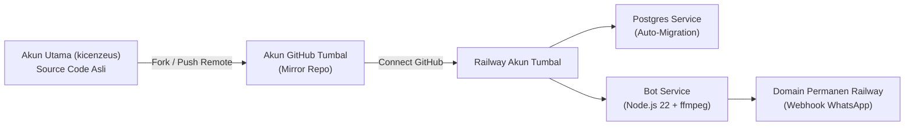

# 🚀 Panduan Lengkap Deploy Jarvis ke Railway Menggunakan Akun Tumbal
> **Status:** Siap Pakai (Cloud-Native Docker + Auto PostgreSQL Migration)  
> **Target:** Deployment 24/7 Gratis menggunakan Akun Tumbal (dengan rotasi akun saat kuota habis).  
> **Arsitektur:** Akun Utama (`kicenzeus` / `tiandoputra`) $\rightarrow$ Akun Tumbal $\rightarrow$ Railway Free Resources.

---

## 📑 Daftar Isi
1. [Konsep & Alur Kerja Multi-Akun](#1-konsep--alur-kerja-multi-akun)
2. [Langkah 1: Sinkronisasi Repo Utama ke Akun Tumbal](#langkah-1-sinkronisasi-repo-utama-ke-akun-tumbal)
3. [Langkah 2: Setup Project di Railway Akun Tumbal](#langkah-2-setup-project-di-railway-akun-tumbal)
4. [Langkah 3: Deploy PostgreSQL Database](#langkah-3-deploy-postgresql-database)
5. [Langkah 4: Deploy Service Bot Jarvis (Docker)](#langkah-4-deploy-service-bot-jarvis-docker)
6. [Langkah 5: Konfigurasi Environment Variables](#langkah-5-konfigurasi-environment-variables)
7. [Langkah 6: Generate Domain Publik & Konfigurasi Webhook WhatsApp](#langkah-6-generate-domain-publik--konfigurasi-webhook-whatsapp)
8. [Langkah 7: Verifikasi & Uji Coba](#langkah-7-verifikasi--uji-coba)
9. [Langkah 8: Prosedur Rotasi Akun Tumbal (Saat Kuota Habis)](#langkah-8-prosedur-rotasi-akun-tumbal-saat-kuota-habis)

---

## 1. Konsep & Alur Kerja Multi-Akun



* **Akun Utama (`kicenzeus`):** Tempat Bos ngoding, commit, dan menyimpan history git asli. Jangan pernah dideploy langsung jika tidak ingin kuota/kredit akun utama kepotong.
* **Akun Tumbal:** Akun GitHub & Railway perantara. Hanya bertugas menampung deployment gratisan. Begitu kuota free tier habis, tinggal ganti akun tumbal baru tanpa merusak repo utama.

---

## Langkah 1: Sinkronisasi Repo Utama ke Akun Tumbal

Pilih salah satu metode di bawah ini sesuai jenis repo Bos (Public atau Private):

### Opsi A: Jika Repo GitHub Akun Utama Berstatus PUBLIC (Paling Mudah)
1. Buka browser dan login ke **Akun GitHub Tumbal**.
2. Kunjungi link repository akun utama Bos:  
   `https://github.com/kicenzeus/Jarvis-Amba` (atau nama repo Bos).
3. Klik tombol **Fork** di pojok kanan atas.
4. Beri nama repo (biarkan default) lalu klik **Create Fork**.
5. *Selesai!* Sekarang repo sudah ada di akun tumbal.  
   *(Setiap kali Bos update kodingan di akun utama, cukup klik tombol **Sync Fork** di repo akun tumbal).*

---

### Opsi B: Jika Repo GitHub Akun Utama Berstatus PRIVATE
Pilih salah satu dari 2 cara ini:

* **Cara 1 (Invite Collaborator - Tanpa Push Ulang):**
  1. Login ke GitHub **Akun Utama (`kicenzeus`)**.
  2. Buka repo $\rightarrow$ **Settings** $\rightarrow$ **Collaborators** $\rightarrow$ **Add people**.
  3. Masukkan username **Akun Tumbal** lalu kirim undangan.
  4. Buka email / notifikasi di Akun Tumbal, klik **Accept Invitation**.
  5. Sekarang Railway di Akun Tumbal bisa langsung membaca repo privat tersebut!

* **Cara 2 (Push Remote Langsung dari Laptop Bos):**
  1. Di Akun GitHub Tumbal, buat repo baru kosong (misal: `jarvis-deploy`).
  2. Buka terminal di laptop Bos (folder project Jarvis), jalankan:
     ```powershell
     # Tambahkan remote kedua bernama 'tumbal'
     git remote add tumbal https://github.com/<USERNAME_AKUN_TUMBAL>/jarvis-deploy.git

     # Push kodingan ke repo tumbal
     git push -u tumbal main
     ```
  3. Tiap kali ada update kodingan yang mau dideploy ke Railway, tinggal ketik `git push tumbal main`.

---

## Langkah 2: Setup Project di Railway Akun Tumbal

1. Buka browser (gunakan mode *Incognito* agar session akun utama tidak bentrok).
2. Kunjungi [railway.com](https://railway.com/) lalu login menggunakan **Akun Tumbal**.
3. Di halaman Dashboard, klik tombol **+ New Project** (atau **Start a New Project**).
4. Pilih opsi **Provision PostgreSQL** terlebih dahulu.

---

## Langkah 3: Deploy PostgreSQL Database

1. Setelah memilih **Provision PostgreSQL**, Railway akan membuatkan service database (kotak ungu bertuliskan **Postgres**).
2. Tunggu ~5–10 detik sampai statusnya **ACTIVE** (berwarna hijau).
3. Database ini sudah langsung siap pakai!  
   *(Sistem bot Jarvis sudah dibekali fitur **Auto-Migration**, sehingga tabel, index, dan view akan otomatis terbuat saat bot pertama kali connect).*

---

## Langkah 4: Deploy Service Bot Jarvis (Docker)

1. Di canvas project Railway yang sama, klik tombol **+ New** di pojok kanan atas (atau tekan `Ctrl + K`).
2. Pilih menu **GitHub Repo**.
3. Pilih repository Jarvis yang ada di akun tumbal (atau repo yang di-share tadi).
4. Railway akan membuat service baru (kotak abu-abu). **JANGAN LANGSUNG DIBIARKAN BUILD DULU.**
5. Klik pada kotak service bot tersebut, lalu masuk ke tab **Settings**:
   * **Service Name:** Ubah menjadi `jarvis-bot` (opsional, agar rapi).
   * **Root Directory (SANGAT PENTING):**
     * Scroll ke bagian **Build**.
     * Cari kolom **Root Directory**, klik **Edit**.
     * Ketik: `discord-bot`
     * Klik **Save**.
     *(Ini wajib karena file `Dockerfile`, `package.json`, dan `bot.js` berada di dalam folder `discord-bot`)*.

---

## Langkah 5: Konfigurasi Environment Variables

1. Masih di dalam service `jarvis-bot`, klik tab **Variables**.
2. Klik tombol **+ New Variable** atau klik **Raw Editor** (mode teks), lalu masukkan variabel-variabel berikut:

| Nama Variable | Value / Nilai | Keterangan |
| :--- | :--- | :--- |
| `DATABASE_URL` | `${{Postgres.DATABASE_URL}}` | **PENTING:** Gunakan sintaks `${{...}}` ini agar Railway otomatis menyambungkan bot ke service Postgres! |
| `DISCORD_TOKEN` | `MTU1OTc0ODQ0Mj...` | Token bot Discord Bos dari Developer Portal |
| `WA_ACCESS_TOKEN` | `EAApaGqGAposBS...` | Token akses Meta Cloud API WhatsApp |
| `WA_PHONE_NUMBER_ID` | `1337369266131974` | ID Nomor Telepon WhatsApp Meta |
| `WA_BUSINESS_ACCOUNT_ID` | `1066128343097037` | ID Akun Bisnis WhatsApp Meta |
| `WA_VERIFY_TOKEN` | `jarvis_amba_wa_secret_2026` | Token rahasia verifikasi webhook |
| `GEMINI_API_KEY` | *(API Key Gemini Bos)* | Dari Google AI Studio |
| `TZ` | `Asia/Jakarta` | Memastikan jam reminder & cron sesuai WIB |
| `OWNER_DISCORD_ID` | `713137141072396370` | Discord ID Bos sebagai Level 4 Owner |

3. Klik **Save** / **Deploy**. Railway akan otomatis memulai build ulang service bot menggunakan variabel tersebut.

---

## Langkah 6: Generate Domain Publik & Konfigurasi Webhook WhatsApp

Dengan Railway, Bos **TIDAK PERLU LAGI memakai Cloudflare Tunnel (`trycloudflare.com`)** yang sering mati atau ganti-ganti URL!

1. Di service `jarvis-bot`, buka tab **Networking**.
2. Pada bagian **Public Networking**, klik tombol **Generate Domain**.
3. Railway akan membuatkan domain HTTPS permanen, contohnya:
   ```text
   jarvis-bot-production-xxxx.up.railway.app
   ```
4. Maka endpoint Webhook WhatsApp Bos sekarang adalah:
   ```text
   https://jarvis-bot-production-xxxx.up.railway.app/webhook/whatsapp
   ```
5. **Update Webhook di Meta Developer Portal:**
   * Buka [developers.facebook.com](https://developers.facebook.com/) $\rightarrow$ Masuk ke App WhatsApp Bos.
   * Pilih menu **WhatsApp** $\rightarrow$ **Configuration**.
   * Di bagian **Webhook**, klik **Edit**.
   * **Callback URL:** Masukkan URL Railway di atas:  
     `https://jarvis-bot-production-xxxx.up.railway.app/webhook/whatsapp`
   * **Verify Token:** `jarvis_amba_wa_secret_2026`
   * Klik **Verify and Save**.  
     *(Jika muncul centang hijau, webhook sudah 100% permanen terhubung tanpa perlu laptop nyala)*.
   * Pastikan webhook fields **messages** tercentang (*Subscribed*).

---

## Langkah 7: Verifikasi & Uji Coba

1. Buka tab **Deployments** di service `jarvis-bot` di Railway, lalu klik **View Logs**.
2. Periksa log keluaran:
   ```text
   ✅ [Migration] 14 migrasi database berhasil diterapkan!
   ✅ Jarvis online sebagai Jarvis#xxxx
   🔔 Listener notifikasi internal aktif di port 5001 (atau $PORT)
   ```
3. Uji coba lewat browser laptop/HP Bos:
   Kunjungi: `https://jarvis-bot-production-xxxx.up.railway.app/health`  
   Maka akan muncul respons JSON:
   ```json
   {
     "overallStatus": "HEALTHY",
     "discordWs": { "ping": 42, "status": "CONNECTED" },
     "database": { "status": "HEALTHY" }
   }
   ```
4. Kirim pesan di WhatsApp dan Discord $\rightarrow$ Bot langsung membalas 24/7!

---

## Langkah 8: Prosedur Rotasi Akun Tumbal (Saat Kuota Habis)

Jika kuota gratisan di Akun Tumbal 1 sudah habis (biasanya mendekati akhir bulan atau setelah limit kredit terpakai), ikuti prosedur rotasi cepat ini (~3 menit):

### 1. Backup Data Database (Opsional tapi Direkomendasikan)
Jika ada data jadwal, tugas, atau memori penting yang mau dipindahkan:
* Di Railway Akun Tumbal lama $\rightarrow$ Klik service **Postgres** $\rightarrow$ Tab **Data** $\rightarrow$ Download backup / dump SQL.

### 2. Pindah ke Akun Tumbal 2
1. Buat/login ke **Akun Tumbal 2** di GitHub & Railway.
2. Di GitHub Akun Tumbal 2, fork atau invite repo dari `kicenzeus` (seperti [Langkah 1](#langkah-1-sinkronisasi-repo-utama-ke-akun-tumbal)).
3. Di Railway Akun Tumbal 2:
   * Buat Project baru $\rightarrow$ Provision PostgreSQL.
   * Deploy GitHub Repo $\rightarrow$ Root Directory: `discord-bot`.
   * Masukkan Environment Variables (copy paste dari tabel [Langkah 5](#langkah-5-konfigurasi-environment-variables)).
   * Generate Domain publik baru.
4. Di Meta Developer Portal:
   * Update Callback URL Webhook dengan domain Railway yang baru.
5. Hapus project di Akun Tumbal lama agar kuotanya bersih.
6. *Selesai!* Bot kembali hidup 24/7 tanpa perlu menyentuh source code di akun utama sama sekali.

