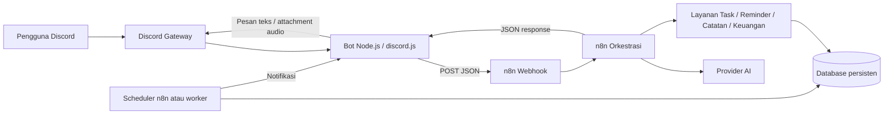

# Arsitektur — Jarvis / Amba

## 1. Prinsip arsitektur

Pisahkan **transport Discord**, **orkestrasi workflow**, **AI**, **layanan bisnis**, dan **penyimpanan**. Bot Node.js menangani event Discord dan file/audio; n8n mengatur urutan kerja dan integrasi; database menyimpan data task, notes, reminder, jadwal, dan transaksi.

## 2. Diagram konteks



## 3. Tanggung jawab komponen

### Discord bot — Node.js

- Login ke Discord dengan `DISCORD_TOKEN` dari `.env`.
- Menerima pesan, attachment, slash command, dan kelak voice events.
- Mengabaikan pesan dari bot agar tidak membuat loop.
- Memastikan user/server masuk allowlist.
- Mengirim payload standar ke n8n dengan `N8N_WEBHOOK_URL`.
- Membaca JSON response n8n.
- Mengirim teks atau file audio ke Discord sesuai `replyMode`.
- Menangani timeout, status non-2xx, dan exception tanpa menampilkan secret.
- Untuk voice channel, mengelola koneksi/audio stream secara khusus; jangan dipaksakan hanya lewat HTTP workflow.

### n8n

- Memulai workflow melalui Webhook `POST /webhook/jarvis-discord`.
- Menormalisasi input berdasarkan struktur output Webhook yang nyata.
- Mengatur AI, routing intent, validasi, serta pemanggilan layanan bisnis.
- Mengembalikan payload response dengan `Respond to Webhook`.
- Mengatur scheduler untuk reminder atau memanggil worker yang sesuai.
- Menyimpan credential menggunakan credential manager n8n bila integrasi langsung ke provider diperlukan.

### AI provider

- Menginterpretasi natural language, mengekstrak intent dan argumen, membuat jawaban.
- Tidak bertanggung jawab menjadi database sumber kebenaran.
- Semua tindakan yang mengubah data harus melewati fungsi/service terstruktur dan mendapat hasil sukses sebelum dikonfirmasi.

### Database

- Menyimpan task, note, reminder, event jadwal, dan transaksi keuangan.
- Menyediakan timestamp, status, user owner, serta audit ringan bila diperlukan.
- Jangan memakai static workflow data sebagai penyimpanan penting untuk produksi.

## 4. Kontrak request bot → n8n

Versi awal payload dari `bot.js`:

```json
{
  "schemaVersion": 1,
  "source": "discord",
  "user": {
    "id": "discord-user-id",
    "username": "username",
    "displayName": "display-name"
  },
  "guild": {
    "id": "discord-guild-id",
    "name": "server-name"
  },
  "message": {
    "id": "discord-message-id",
    "content": "pesan pengguna",
    "channelId": "discord-channel-id",
    "channelName": "channel-name"
  },
  "attachments": [],
  "timestamp": "2026-10-14T03:00:00.000Z"
}
```

Field `guild` dan `attachments` merupakan target penambahan yang direkomendasikan, bukan jaminan telah ada di kode sekarang. Saat mengubah kontrak, jaga kompatibilitas dan update dokumentasi serta test.

**Catatan n8n:** output node Webhook biasanya menyimpan body request di properti `$json.body`. Periksa execution data nyata sebelum menulis ekspresi seperti `channelId`; jangan mengasumsikan payload langsung berada di `$json.message`.

## 5. Kontrak response n8n → bot

Untuk respons teks awal:

```json
{
  "success": true,
  "replyText": "Halo! Pesan lo sudah masuk ke n8n 🤖",
  "replyMode": "text",
  "requestId": "optional-correlation-id"
}
```

Untuk respons yang menandakan output voice note:

```json
{
  "success": true,
  "replyText": "Ini jawaban yang akan diucapkan.",
  "replyMode": "voice_note",
  "requestId": "optional-correlation-id"
}
```

Response `voice_note` belum berarti audio sudah dibuat. Bot/workflow selanjutnya harus menghasilkan audio dan menyertakan attachment/URL yang aman dan bisa diambil bot, misalnya `audioUrl` dengan kedaluwarsa atau storage internal. Jangan mengirim URL publik tanpa kontrol akses.

Untuk kegagalan:

```json
{
  "success": false,
  "replyText": "Maaf, permintaan belum berhasil diproses.",
  "errorCode": "SAFE_ERROR_CODE",
  "requestId": "optional-correlation-id"
}
```

Jangan sertakan stack trace, token, prompt internal, atau detail credential pada response.

## 6. Perbaikan jalur balasan yang direkomendasikan

Saat ini workflow sempat memakai HTTP Request ke Discord REST API, tetapi ekspresi channel ID kosong dan request gagal `405 Method Not Allowed`.

**Pendekatan utama untuk MVP:**

1. Ubah konfigurasi Webhook agar workflow mengembalikan respons melalui `Respond to Webhook`.
2. Gunakan HTTP body response JSON sesuai kontrak.
3. Bot membaca response tersebut dari `fetch()`.
4. Jika `success === true` dan `replyMode === 'text'`, bot membalas `message.reply(replyText)`.
5. Dengan pendekatan ini, token bot tetap hanya berada di bot Node.js, bukan di node HTTP Request n8n.

Jika agent memilih tetap memakai Discord REST API dari n8n, agent wajib memeriksa output data aktual, memakai credential storage aman, memastikan endpoint dan channel ID valid, lalu menambahkan tes untuk status HTTP.

## 7. Tahap penggunaan URL

- Pengembangan test: `http://localhost:5678/webhook-test/jarvis-discord`, hanya ketika workflow sedang Listen for test event.
- Penggunaan reguler lokal: simpan dan aktifkan workflow, lalu gunakan Production URL, lazimnya `http://localhost:5678/webhook/jarvis-discord`.
- Simpan URL di `.env` sebagai `N8N_WEBHOOK_URL`, jangan hardcode di `bot.js`.
- Jika bot nantinya dipindah ke container Docker yang sama, `localhost` di dalam container menunjuk ke container itu sendiri. Gunakan nama service dan jaringan Docker, misalnya `http://n8n:5678/webhook/jarvis-discord`, setelah konfigurasi compose diverifikasi.

## 8. Keamanan operasional

- `.env`, token Discord, dan API keys wajib di-ignore dari Git.
- Sediakan `.env.example` tanpa nilai rahasia.
- Jangan log header Authorization, token, konten audio, atau data keuangan secara penuh.
- Terapkan allowlist user dan server.
- Validasi body, panjang pesan, attachment, tanggal/waktu, serta ukuran file.
- Batasi timeout dan ukuran response; gunakan deduplication berdasarkan `message.id` untuk operasi yang mengubah data.
- Pisahkan data development dan production.
