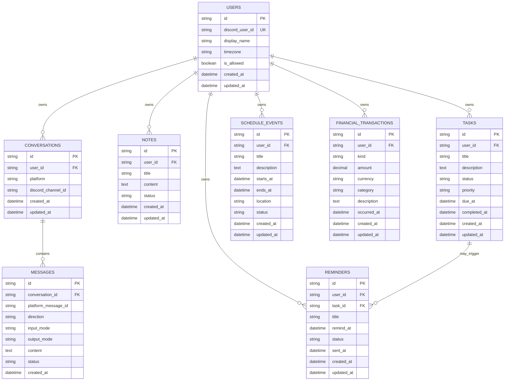

# Model Data Awal (ERD Konseptual)

Ini rancangan awal untuk fitur jangka menengah. **Belum tentu sudah dibuat di proyek saat ini.** Agent harus menyesuaikan rancangan ini setelah memilih database serta memeriksa implementasi aktual. Jangan membuat database/schema baru secara membabi buta jika proyek ternyata sudah punya penyimpanan.

## ERD

## Entitas dan aturan

- `USERS`: pengguna Discord yang diizinkan. `discord_user_id` unik; jangan menggunakan username sebagai kunci karena dapat berubah.
- `CONVERSATIONS`: konteks percakapan per user/channel, hanya simpan data minimum yang dibutuhkan.
- `MESSAGES`: metadata untuk konteks dan troubleshooting. Tetapkan kebijakan retensi; tidak wajib menyimpan seluruh pesan mentah.
- `NOTES`: catatan milik user.
- `TASKS`: pekerjaan dengan status, prioritas, serta batas waktu opsional.
- `REMINDERS`: pengingat satu kali atau berulang pada iterasi berikutnya; status minimal `pending`, `sent`, `cancelled`, `failed`.
- `SCHEDULE_EVENTS`: jadwal dan rentang waktu. Validasi `ends_at >= starts_at`.
- `FINANCIAL_TRANSACTIONS`: `kind` minimal `income` atau `expense`, `amount > 0`, `currency` default `IDR`. Rekap harus menghitung dari data tersimpan, bukan perkiraan AI.

## Indeks/constraint yang disarankan

- Unique: `USERS.discord_user_id`.
- Indeks: `(REMINDERS.status, REMINDERS.remind_at)` untuk mencari reminder jatuh tempo.
- Indeks: `(TASKS.user_id, TASKS.status, TASKS.due_at)`.
- Indeks: `(FINANCIAL_TRANSACTIONS.user_id, occurred_at, kind)`.
- Idempotensi event Discord berdasarkan `platform_message_id` jika data pesan/event disimpan.
- Semua record pengguna memiliki FK pemilik supaya data user tidak tercampur.

## Catatan implementasi

1. Konfirmasi pilihan database dan lokasi runtime sebelum membuat migrasi. Untuk local-first gunakan database persisten yang didukung deployment, bukan hanya variabel di memori.
2. Simpan waktu dalam format yang konsisten (umumnya UTC) lalu tampilkan berdasarkan timezone user, default `Asia/Jakarta`.
3. Gunakan transaksi DB untuk operasi pencatatan keuangan/task bila beberapa perubahan harus atomik.
4. Jangan menyimpan token, kata sandi, atau audio berisi data pribadi ke tabel pesan.
5. Model ini bisa diperkecil untuk MVP, tetapi lakukan migrasi yang eksplisit agar tidak kehilangan data saat berkembang.
